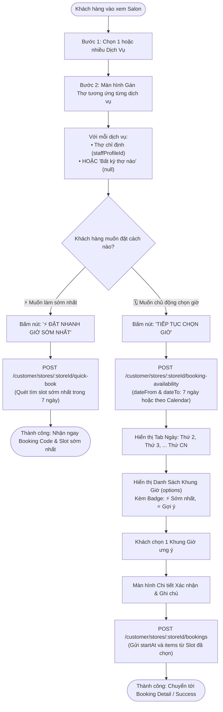

# TÀI LIỆU TÍCH HỢP LUỒNG ĐẶT LỊCH MỚI — CUSTOMER / USER APP
> **Hệ thống Spa & Salon Booking (Mobile App Flutter / Web User Client)**  
> **Phiên bản:** 2.0 (Scheduling & Continuous Availability Engine)  
> **Cập nhật:** 2026-10-12  
> **Tài liệu nguồn:** `FE_CUSTOMER_BOOKING_SCHEDULING_INTEGRATION_GUIDE.md`

---

## 1. TỔNG QUAN THAY ĐỔI LUỒNG BOOKING (CHANGE LOG)

### 1.1. So Sánh Luồng Cũ vs Luồng Mới

| Đặc điểm | Luồng Cũ (Old Flow) | Luồng Mới (New Flow - v2.0) |
| :--- | :--- | :--- |
| **Bắt đầu** | Chọn dịch vụ từ danh sách | Khách tick chọn 1 hoặc nhiều dịch vụ (Multi-service) |
| **Bước tiếp theo** | Chọn giờ trực tiếp trên lưới thời gian (Schedule Grid Matrix) | **Chuyển sang màn hình Gán Thợ (Staff Specialist Assignment)** cho từng dịch vụ |
| **Lựa chọn Thợ** | Chỉ chọn 1 thợ chung hoặc chọn thợ ở cột grid | Từng dịch vụ có thể chỉ định thợ riêng hoặc chọn **"Bất kỳ thợ nào (Tối ưu)"** (`staffProfileId: null`) |
| **Tùy chọn Đặt Nhanh** | Chưa có | **Nút "⚡ ĐẶT NHANH GIỜ SỚM NHẤT" (Quick-Book 1-Chạm)** |
| **Cơ chế tính lịch** | Tra cứu slot theo từng giờ tĩnh | **Thuật toán Khung giờ liên tục (Continuous Availability)**: Tự động ghép nối các dịch vụ không đứt quãng, tự đảo thứ tự tối ưu (`orderMode: FLEXIBLE`) |
| **Tra cứu theo ngày** | Chỉ xem từng ngày đơn lẻ | **Hỗ trợ quét 7 ngày liên tiếp (Mặc định)** hoặc khoảng ngày (`dateFrom` $\to$ `dateTo`). Response nhóm sẵn theo `days[]` |
| **Gợi ý & Badge** | Không có tag đề xuất | Tự động gắn tag: `EARLIEST` (⚡ Sớm nhất), `RECOMMENDED` (⭐ Đề xuất), `BEST_FIT` |

---

## 2. SƠ ĐỒ NGHIỆP VỤ & TRẢI NGHIỆM NGƯỜI DÙNG (USER JOURNEY)



---

## 3. CHI TIẾT CÁC MÀN HÌNH & GIAO DIỆN (UI/UX SPECIFICATION)

### Màn hình 1: Chọn Dịch Vụ (Select Services Screen)
- **Chức năng:** Cho phép khách hàng tìm kiếm, lọc theo chuyên mục (Hair, Spa, Nail, Massage...) và tick chọn từ 1 đến nhiều dịch vụ.
- **Thanh tổng kết dưới cùng:**
  - Hiển thị: Tổng số dịch vụ đã chọn, tổng thời gian dự kiến (phút), tổng tiền dự kiến (VND).
  - Nút bấm: **"Tiếp Tục Chọn Thợ"** (Chỉ kích hoạt khi chọn ít nhất 1 dịch vụ).

---

### Màn hình 2: Gán Chuyên Viên & Tùy Chọn Đặt Nhanh (Staff Assignment Screen)
Đây là màn hình mới làm cầu nối giữa Dịch Vụ và Lịch Hẹn.
- **Danh sách dịch vụ đã chọn:** Mỗi dịch vụ hiển thị thành 1 Card riêng:
  - Tên dịch vụ, thời lượng, giá tiền.
  - Dropdown / Horizontal Avatar List chọn thợ cho dịch vụ đó:
    - **Item đầu tiên (Mặc định):** Icon Auto/Shuffle $\to$ *"Bất kỳ thợ nào (Hệ thống tự sắp xếp)"* (`staffProfileId = null`).
    - **Các Item tiếp theo:** Avatar + Họ tên thợ lấy từ API nhân viên có kỹ năng làm dịch vụ này:
      ```http
      GET /api/v1/public/stores/:storeId/staff?serviceId=:serviceId
      ```
- **Khu vực Nút Hành Động (Bottom Bar / Actions):**
  1. **Nút Nổi Bật (Secondary / Quick Action):**  
     `⚡ ĐẶT NHANH GIỜ SỚM NHẤT` (Gradient / Amber-Coral highlight).
     - Khi bấm: Mở Popup xác nhận hoặc gọi trực tiếp API `quick-book`.
     - Cho phép khách chọn ngày bắt đầu tìm (Mặc định là Hôm nay $\to$ 7 ngày tới).
  2. **Nút Chính (Primary Action):**  
     `XEM KHUNG GIỜ KHẢ DỤNG ➔`  
     - Chuyển sang Màn hình Chọn Giờ liên tục.

---

### Màn hình 3: Chọn Khung Giờ Khả Dụng (Continuous Availability Schedule Screen)
Màn hình này thay thế cho lưới Grid ma trận cũ bằng giao diện Time Slot hiện đại, tối ưu cho thiết bị di động:
1. **Header Chọn Khoảng Ngày / Lịch (Date Range Bar):**
   - Danh sách cuộn ngang các ngày trong tuần (Tab Bar Ngày: `Thứ 5 (15/10)`, `Thứ 6 (16/10)`...).
   - Hiển thị badge số lượng slot trống của từng ngày (`totalSlots`).
   - Icon Calendar ở góc: Cho phép chọn khoảng ngày tùy chỉnh (`dateFrom` $\to$ `dateTo`).
2. **Body - Danh sách Khung Giờ Liên Tục (Slot Options List):**
   - Hiển thị các khối giờ dạng Card:
     - Giờ bắt đầu - Giờ kết thúc: `09:00 - 10:30` (Tổng 90 phút).
     - Badge thông minh:
       - `slotTag === 'EARLIEST'`: ⚡ **Sớm nhất trong ngày** (Badge xanh lá cây).
       - `isRecommended === true`: ⭐ **Khuyên dùng / Tiết kiệm thời gian** (Badge vàng kim).
       - `slotTag === 'BEST_FIT'`: 🎯 **Khớp lịch thợ ruột**.
     - Danh sách chi tiết bên trong slot (Accordion hoặc preview):
       - `09:00 - 09:30`: Cắt tóc tạo kiểu (Thợ: Mai Nguyễn).
       - `09:30 - 10:30`: Gội đầu dưỡng sinh (Thợ: Tuấn Trần).
3. **Bottom Bar:**
   - Khi bấm chọn 1 Slot $\to$ Nút **"Xác Nhận Đặt Giờ Này"** sáng lên.
   - Chuyển sang màn hình xác nhận thông tin & ghi chú trước khi tạo lịch.

---

## 4. ĐẶC TẢ CHI TIẾT API BACKEND (API SPECIFICATION)

### 4.1. API Lấy Danh Sách Nhân Viên Theo Từng Dịch Vụ
- **Endpoint:** `GET /api/v1/public/stores/:storeId/staff`
- **Query Parameters:** `serviceId=<string>`
- **Response:**
```json
{
  "success": true,
  "data": [
    {
      "staffProfileId": "a0b15911-a700-494e-a305-fb399d925ad5",
      "fullName": "Mai Nguyễn",
      "avatarUrl": "https://cdn.example.com/staff/mai.jpg",
      "rating": 4.9,
      "isAvailable": true
    }
  ]
}
```

---

### 4.2. API Tra Cứu Khung Giờ Khả Dụng (Continuous Availability)
- **Endpoint:**
  - Khách đã đăng nhập: `POST /api/v1/customer/stores/:storeId/booking-availability`
  - Khách vãng lai / Public: `POST /api/v1/public/stores/:storeId/booking-availability`
- **Headers:** `Authorization: Bearer <accessToken>` (nếu đã đăng nhập)
- **Request Body:**

```json
{
  "services": [
    {
      "serviceId": "daec9bbe-decb-49b8-93dd-3db188304b53",
      "staffProfileId": "a0b15911-a700-494e-a305-fb399d925ad5"
    },
    {
      "serviceId": "c6b3f065-357f-4c93-94dc-dfdcfa667df4",
      "staffProfileId": null
    }
  ],
  "dateFrom": "2026-10-15",
  "dateTo": "2026-10-21",
  "mode": "SLOT_SEARCH",
  "orderMode": "FLEXIBLE",
  "stepMinutes": 15,
  "currency": "VND"
}
```

> **Lưu ý quan trọng về ngày (Date params):**  
> - Nếu **KHÔNG truyền** `dateFrom` và `dateTo`: Backend sẽ tự động quét **7 ngày liên tiếp** tính từ ngày hôm nay!  
> - Nếu **CÓ truyền**: Hệ thống quét chính xác trong khoảng ngày đã chỉ định.

- **Response Body:**

```json
{
  "storeId": "38662a33-fd26-490a-8982-f8cf6c310e26",
  "totalDurationMinutes": 90,
  "currency": "VND",
  "days": [
    {
      "date": "2026-10-15",
      "dayOfWeek": "THURSDAY",
      "totalSlots": 2,
      "options": [
        {
          "date": "2026-10-15",
          "startTime": "09:00",
          "endTime": "10:30",
          "startAt": "2026-10-15T02:00:00.000Z",
          "endAt": "2026-10-15T03:30:00.000Z",
          "totalDurationMinutes": 90,
          "estimatedPrice": 470000,
          "currency": "VND",
          "efficiencyScore": 95,
          "isRecommended": true,
          "slotTag": "EARLIEST",
          "items": [
            {
              "serviceId": "daec9bbe-decb-49b8-93dd-3db188304b53",
              "serviceName": "Cắt tóc tạo kiểu Hàn Quốc",
              "durationMinutes": 30,
              "startTime": "09:00",
              "endTime": "09:30",
              "startAt": "2026-10-15T02:00:00.000Z",
              "endAt": "2026-10-15T02:30:00.000Z",
              "staffProfileId": "a0b15911-a700-494e-a305-fb399d925ad5",
              "staffName": "Mai Nguyễn",
              "estimatedPrice": 120000
            },
            {
              "serviceId": "c6b3f065-357f-4c93-94dc-dfdcfa667df4",
              "serviceName": "Gội đầu dưỡng sinh",
              "durationMinutes": 60,
              "startTime": "09:30",
              "endTime": "10:30",
              "startAt": "2026-10-15T02:30:00.000Z",
              "endAt": "2026-10-15T03:30:00.000Z",
              "staffProfileId": "b1c25911-b800-494e-b405-ec399d925ac1",
              "staffName": "Tuấn Trần",
              "estimatedPrice": 350000
            }
          ]
        }
      ]
    }
  ],
  "options": [ ... ]
}
```

---

### 4.3. API Đặt Lịch Nhanh 1-Chạm (Quick Book Earliest)
- **Endpoint:** `POST /api/v1/customer/stores/:storeId/quick-book`
- **Headers:** `Authorization: Bearer <accessToken>`
- **Request Body:**

```json
{
  "services": [
    {
      "serviceId": "daec9bbe-decb-49b8-93dd-3db188304b53",
      "staffProfileId": "a0b15911-a700-494e-a305-fb399d925ad5"
    },
    {
      "serviceId": "c6b3f065-357f-4c93-94dc-dfdcfa667df4",
      "staffProfileId": null
    }
  ],
  "preferredDate": "2026-10-15",
  "orderMode": "FLEXIBLE",
  "stepMinutes": 15,
  "paymentMethod": "CASH",
  "note": "Khách cần làm nhanh gọn"
}
```

- **Response Body:** Trả về đối tượng `Booking` với trạng thái `CONFIRMED` và lịch sớm nhất tìm được.

---

### 4.4. API Đặt Theo Khung Giờ Khách Đã Chọn (Standard Booking)
- **Endpoint:** `POST /api/v1/customer/stores/:storeId/bookings`
- **Headers:** `Authorization: Bearer <accessToken>`
- **Request Body:**

```json
{
  "startAt": "2026-10-15T02:00:00.000Z",
  "items": [
    {
      "serviceId": "daec9bbe-decb-49b8-93dd-3db188304b53",
      "staffProfileId": "a0b15911-a700-494e-a305-fb399d925ad5"
    },
    {
      "serviceId": "c6b3f065-357f-4c93-94dc-dfdcfa667df4",
      "staffProfileId": "b1c25911-b800-494e-b405-ec399d925ac1"
    }
  ],
  "note": "Chuẩn bị nước ấm giúp tôi"
}
```

---

## 5. MÔ HÌNH DỮ LIỆU DART / FLUTTER (DATA MODELS)

```dart
// 1. Item chọn dịch vụ & thợ
class ServicePreferenceItem {
  final String serviceId;
  final String? staffProfileId;

  const ServicePreferenceItem({
    required this.serviceId,
    this.staffProfileId,
  });

  Map<String, dynamic> toJson() => {
    'serviceId': serviceId,
    if (staffProfileId != null) 'staffProfileId': staffProfileId,
  };
}

// 2. Từng dịch vụ trong 1 Slot liên tục
class ContinuousSlotItem {
  final String serviceId;
  final String serviceName;
  final int durationMinutes;
  final String startTime;
  final String endTime;
  final DateTime startAt;
  final DateTime endAt;
  final String? staffProfileId;
  final String? staffName;
  final double estimatedPrice;

  ContinuousSlotItem({
    required this.serviceId,
    required this.serviceName,
    required this.durationMinutes,
    required this.startTime,
    required this.endTime,
    required this.startAt,
    required this.endAt,
    this.staffProfileId,
    this.staffName,
    required this.estimatedPrice,
  });

  factory ContinuousSlotItem.fromJson(Map<String, dynamic> json) {
    return ContinuousSlotItem(
      serviceId: json['serviceId'] ?? '',
      serviceName: json['serviceName'] ?? '',
      durationMinutes: json['durationMinutes'] ?? 0,
      startTime: json['startTime'] ?? '',
      endTime: json['endTime'] ?? '',
      startAt: DateTime.parse(json['startAt']),
      endAt: DateTime.parse(json['endAt']),
      staffProfileId: json['staffProfileId'],
      staffName: json['staffName'],
      estimatedPrice: (json['estimatedPrice'] as num?)?.toDouble() ?? 0.0,
    );
  }
}

// 3. Khung giờ khả dụng (Option)
class ContinuousSlotOption {
  final String date;
  final String startTime;
  final String endTime;
  final DateTime startAt;
  final DateTime endAt;
  final int totalDurationMinutes;
  final double estimatedPrice;
  final bool isRecommended;
  final String slotTag; // 'EARLIEST' | 'BEST_FIT' | 'RECOMMENDED' | 'STANDARD'
  final List<ContinuousSlotItem> items;

  ContinuousSlotOption({
    required this.date,
    required this.startTime,
    required this.endTime,
    required this.startAt,
    required this.endAt,
    required this.totalDurationMinutes,
    required this.estimatedPrice,
    required this.isRecommended,
    required this.slotTag,
    required this.items,
  });

  factory ContinuousSlotOption.fromJson(Map<String, dynamic> json) {
    return ContinuousSlotOption(
      date: json['date'] ?? '',
      startTime: json['startTime'] ?? '',
      endTime: json['endTime'] ?? '',
      startAt: DateTime.parse(json['startAt']),
      endAt: DateTime.parse(json['endAt']),
      totalDurationMinutes: json['totalDurationMinutes'] ?? 0,
      estimatedPrice: (json['estimatedPrice'] as num?)?.toDouble() ?? 0.0,
      isRecommended: json['isRecommended'] ?? false,
      slotTag: json['slotTag'] ?? 'STANDARD',
      items: ((json['items'] as List?) ?? [])
          .map((item) => ContinuousSlotItem.fromJson(item))
          .toList(),
    );
  }
}

// 4. Nhóm Khung Giờ Theo Ngày (Day Schedule)
class DayAvailabilitySchedule {
  final String date;
  final String dayOfWeek;
  final int totalSlots;
  final List<ContinuousSlotOption> options;

  DayAvailabilitySchedule({
    required this.date,
    required this.dayOfWeek,
    required this.totalSlots,
    required this.options,
  });

  factory DayAvailabilitySchedule.fromJson(Map<String, dynamic> json) {
    return DayAvailabilitySchedule(
      date: json['date'] ?? '',
      dayOfWeek: json['dayOfWeek'] ?? '',
      totalSlots: json['totalSlots'] ?? 0,
      options: ((json['options'] as List?) ?? [])
          .map((opt) => ContinuousSlotOption.fromJson(opt))
          .toList(),
    );
  }
}
```

---

## 6. XỬ LÝ LỖI & NGOẠI LỆ (EXCEPTION HANDLING)

| Mã lỗi | Nguyên nhân | Phương án xử lý trên UI |
| :--- | :--- | :--- |
| **`409 CONFLICT`** | Giờ hoặc thợ vừa bị khách khác đặt trước (Race Condition). | Hiển thị Toast thông báo: *"Khung giờ này vừa có khách đặt trước, đang làm mới danh sách..."*, sau đó tự động gọi lại API `booking-availability`. |
| **`404 NOT FOUND`** | Khi dùng Quick-Book mà toàn bộ slot trong 7 ngày đều kín. | Hiển thị Dialog: *"Rất tiếc salon đã kín lịch trong tuần này. Quý khách vui lòng chọn ngày khác hoặc đổi thợ."* |
| **`400 BAD REQUEST`** | Khách đặt quá sát giờ quy định (`minBookingNoticeMinutes`) hoặc quá xa ngày cho phép. | Hiển thị SnackBar thông báo lý do chính xác từ Backend (`message`). |

---

## 7. CHECKLIST TRIỂN KHAI CHO DEV APP USER

- [ ] **Bước 1:** Cập nhật `BookingRemoteDataSource` thêm 2 hàm: `queryBookingAvailability()` và `quickBookEarliest()`.
- [ ] **Bước 2:** Cập nhật `BookingRepository` và `BookingRepositoryImpl`.
- [ ] **Bước 3:** Tạo màn hình `AssignStaffForServicesView` (hoặc tích hợp bước chọn thợ cho từng dịch vụ vào flow hiện tại).
- [ ] **Bước 4:** Thêm nút `⚡ Đặt Nhanh Giờ Sớm Nhất` kích hoạt Action `QuickBookEarliestEvent`.
- [ ] **Bước 5:** Nâng cấp `BookingScheduleView` từ việc render bảng grid tĩnh sang Tab Ngày (`days[]`) và danh sách thẻ Slot thông minh.
- [ ] **Bước 6:** Đính kèm badge `⚡ SỚM NHẤT` (màu xanh lá) và `⭐ GỢI Ý` (màu vàng kim).
- [ ] **Bước 7:** Kiểm thử luồng Đặt Lịch với Store thật trên môi trường Test/Staging.
